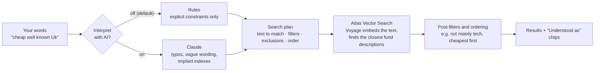

# Fund Finder

Find UK funds by describing them in plain English, or start from a fund and find others like it.
A prototype over real UK funds (Open Ended Investment Companies from Morningstar), using MongoDB
Atlas Vector Search with Voyage embeddings,
plus an optional AI mode (Claude) that reads what you mean rather than what you typed.

**Full walkthrough:** [docs/how-it-works.md](docs/how-it-works.md) explains the data, the two
similarity methods, indexes, the request flow, rank fusion, query understanding, cost ordering,
evaluation and deployment.

## How search works



1. **Read the query.** Constraints are separated from the description, so they act as real filters
   rather than nudging the match:
   - **Standard reading (default):** deterministic rules (`fundfinder/understanding.py`) pick out
     explicit constraints:
     - cost caps ("under 0.2%", "below 15bps")
     - fund type ("index funds", "tracker", "actively managed")
     - one asset class ("bonds", "property")
     - negations ("not tech", "ex UK", "no bonds", "not commodities")
     - cost order ("cheapest", "most expensive")
     - alternatives ("tech or healthcare", "UK or European equity"): each side is searched on
       its own and the results interleaved, so one side can't crowd out the other

     Places and themes such as "Japan" or "healthcare" are left to the match.
   - **Interpret with AI (opt-in toggle):** Claude (`fundfinder/llm_intent.py`) reads the whole
     query. It fixes typos, turns vague wording into fund language ("well known UK" means the
     FTSE 100; "safe" points to gilts) and can pick the index you clearly mean. It returns the
     same kind of plan plus a one-line summary of how it read you.
2. **Match on meaning.** Atlas embeds the remaining descriptive text with Voyage `voyage-4` and
   finds the funds whose descriptions are closest (approximate nearest neighbour search, with the
   filters applied before ranking).
3. **Finish.** Exclusions that can't be pre-filtered are applied: "not mainly tech" means funds
   with 50% or more in tech, and "tracks the FTSE 100" keeps only those trackers. If you asked
   about cost, the matches are then re-ordered by cost.
4. **Show what was understood.** Each constraint appears as an **Understood as** chip. Remove one
   to search again without it. Filters and an order you choose yourself always win.

| You type | Standard reading | Interpret with AI |
|---|---|---|
| `index funds under 0.15% a year, not tech` | Index funds only · 0.15% or less · not mainly tech; searches "index funds" | Same constraints, shown cheapest first, plus a plain-English summary |
| `funds under 0.1% in S&P` | 0.10% or less; searches "funds in S&P" (the S&P fund ranks first, then other cheap funds) | Tracks the S&P 500 · index funds · 0.10% or less: just the one matching fund |
| `cheap well known Uk` | Cheapest first; searches the words as typed | Tracks the FTSE 100 · index funds · equity · cheapest first: the five FTSE 100 trackers |
| `safe place for my savings` | No constraints; searches the words as typed | Searches for UK government bonds and money market funds |

**Turning on AI search:** put `ANTHROPIC_API_KEY` in `.env` (or in your Vercel project settings).
Without it the toggle shows as unavailable and everything else works as normal. The model
defaults to `claude-haiku-5-5` (`INTENT_MODEL`).
- **Speed:** a new query takes about 1.5–2 s, because Claude reads it first. Repeats, filter
  changes and chip removals reuse a cached reading (about 0.2 s).
- **Safety:** Claude's reply is checked against the values that exist in the data, so it can only
  narrow a search to real options.
- **Cost:** AI searches are limited per client IP (`LLM_RATE_PER_MIN`) and in total
  (`LLM_DAILY_BUDGET`); past either limit `/search?intent=llm` returns 429 with `Retry-After`.
- **Fallback:** if the call fails, search uses the standard reading and says so.
- **Cost:** on a public deployment anyone can trigger calls on your key, so keep deployment
  protection on.

## Local run

Prerequisites: [uv](https://docs.astral.sh/uv/), Node 24, Docker.

### Option A: everything in Docker, with local Atlas (no cloud cluster needed)

`compose.yaml` runs `mongodb/mongodb-atlas-local:preview` (mongod + mongot with Vector Search and
Automated Embedding) alongside the app. Embedding still calls Voyage, so put `VOYAGE_API_KEY` in
`.env` first. For a key created directly at voyageai.com, also set
`VOYAGE_EMBEDDING_PROVIDER_ENDPOINT=https://api.voyageai.com/v1/embeddings`.

```bash
cp .env.example .env                                     # add VOYAGE_API_KEY (+ ANTHROPIC_API_KEY for AI search)
docker compose up -d                                     # mongo + app on http://localhost:8000 (rebuilds the app)
docker compose run --rm app python -m scripts.seed_morningstar --all   # real funds; scripts.seed for synthetic
docker compose run --rm app python -m scripts.indexes    # waits until READY
```

With a free Voyage key (3 req/min, 10K tokens/min) the first `profile_auto` build takes about
20 minutes. With a payment method on the key it takes about one minute.

### Option B: develop with hot reload

```bash
uv sync && (cd web && npm install)
uv run uvicorn fundfinder.main:app --reload     # API on :8000 (uses MONGODB_URI from .env)
cd web && npm run dev                           # UI on http://localhost:5173, proxies the API
```

To point the API or scripts at the local Docker Mongo instead of Atlas, prefix commands with
`MONGODB_URI="mongodb://localhost:27017/?directConnection=true"`.

### Real funds from Morningstar (the default)

The app searches the `funds_morningstar` collection unless `FUNDS_COLLECTION` says otherwise.
`scripts/seed_morningstar.py` fills it with real UK funds. It walks Morningstar's security
list, keeps Open Ended Investment Companies that have an IA sector, then fetches each one's
snapshot by SEDOL. It keeps one share class per fund and spreads its picks across IA sectors.
`--all` loads every fund; without it the run stops at 300 (`--limit`). The mapping lives in
`fundfinder/data/morningstar.py`.

```bash
uv run python -m scripts.seed_morningstar --all --cache .cache/morningstar   # --dry-run to preview
uv run python -m scripts.indexes
```

The synthetic universe (below) lives in the `funds` collection. Search it with
`FUNDS_COLLECTION=funds`.

Some fields are approximations:

- Morningstar's 11 equity sectors stand in for the GICS sectors.
- "Passive" is read from the fund name (index, tracker, ETF), since the snapshot has no
  index flag.
- Real funds have no evaluation clusters, so `scripts/eval.py` still runs on the synthetic
  data only.

## Frontend

`web/` is a React 19 + TypeScript app built with Vite. The production build is baked into the
same Docker image and served by FastAPI at `/` and `/fund/{id}`. There's no frontend server.

The app is designed for people who don't know fund jargon. The natural-language search is the
centrepiece, set in a calm card layout (Geist; forest, cream, lilac and amber palette; light and
dark themes).

- **Search:** describe a fund in plain English.
  - Results show the fund type, annual cost and a plain-language match strength ("Strong", "Good"
    or "Loose" match).
  - **Understood as** chips show the constraints read from your words; each can be removed.
  - A **Best match / Lowest cost / Highest cost** switch sets the order.
  - Filters are fund type, asset type and cost.
  - The **Interpret with AI** toggle under the search box (off by default) switches to the AI
    reading and adds its one-line summary.
  - All state lives in the URL, so searches can be shared.
- **How it works:** the three methods (description, holdings, combined) shown as coloured blocks,
  then a step-by-step guide, how to read results, search tips and an FAQ.
- **Fund page:** the key facts, what it says it does, what it invests in, its biggest holdings, and
  **Funds like this**. That list is the fused ranking, and each fund says why it matched:
  "Similar description and holdings" (top 10 of both methods), "Similar description" or "Similar
  holdings". "How we found these" turns the same information into a gauge. "Only cheaper than"
  keeps the matched funds that cost less, cheapest first (it doesn't search for cheaper funds).
- **Expert mode** (switch in the top bar, remembered per browser) adds the technical layer:
  - scores, ranks and exposure fingerprints
  - limit, numCandidates and ANN/exact settings
  - an IA sector filter
  - test sets and designed-sibling counts
  - a side-by-side comparison of the three methods
- **Fewer Voyage calls:** a normal fund page makes one Voyage call (fused mode). The comparison
  view adds one more, and only when it's switched on.
- **Rate limits:** a request throttled by Voyage (HTTP 429) retries itself with a visible
  countdown.

```bash
cd web && npm run typecheck && npm test && npm run build
```

## Data and seeding

Besides the real Morningstar funds (above), `fundfinder/data/synthetic.py` generates a
deterministic universe of 300 UK funds (fictional providers, made-up weights). The clusters below are built in deliberately,
for evaluation, and labelled with `cluster_id`:

| Kind | `cluster_id` | Members |
|---|---|---|
| Index trackers from different providers | `trk_ftse100`, `trk_ftse_allshare`, `trk_sp500`, `trk_msci_world`, `trk_global_agg`, `trk_ftse_gilts` | 5 each |
| Near-duplicate active funds | `act_uk_income`, `act_global_tech`, `act_uk_smaller`, `act_strat_bond`, `act_japan_value` | 4 each |
| Outliers (no true neighbours) | `outlier_gold`, `outlier_frontier`, `outlier_india`, `outlier_biotech`, `outlier_direct_property` | 1 each |

The other ~245 funds are background noise scattered around 22 IA-sector archetypes. FTSE 100 and
FTSE All-Share trackers are deliberately close to each other (a hard negative).

Each document also stores two derived fields:

- `profile`: text built from name, objective, IA sector, passive/active, top holdings, main GICS
  sectors and region split. This is what Atlas embeds.
- `exposure_vector`: 26 dims = 11 GICS sectors (whole-portfolio terms) | 8 regions | 7 asset
  classes, the last two blocks normalised to sum 1, then the whole vector L2-normalised.

```bash
uv run python -m scripts.seed --dry-run   # summary + sample document, no writes
uv run python -m scripts.seed             # upsert into Atlas
```

Seeding is idempotent: it upserts each fund and deletes funds no longer in the source. It never
drops the collection, so search indexes survive, and unchanged documents aren't re-embedded.
To plug in real data later, implement `FundSource.fetch()` (`fundfinder/data/source.py`) and pass
it to `scripts/seed.py`.

## Indexes

Two of the three search/vector indexes a Free cluster allows:

| Index | Type | Field | Filters |
|---|---|---|---|
| `profile_auto` | `autoEmbed` (Atlas Automated Embedding, `voyage-4`) | `profile` | `asset_class`, `ia_sector`, `ocf`, `is_passive` |
| `exposure_vec` | `vector`, 26 dims, cosine | `exposure_vector` | same |

```bash
uv run python -m scripts.indexes          # create/update, wait until READY (--timeout, default 30 min)
```

The script is idempotent: missing indexes are created, changed definitions are updated in place,
and matching ones are left alone. Run it after seeding, because the collection must exist.

Atlas embeds each `profile` when it indexes it, and embeds query text at query time, using the
Voyage key registered in **Atlas** (not `VOYAGE_API_KEY`). **A Voyage key without a payment
method is limited to 3 requests/minute**, and every text query is one request. The API returns
`429` when it's throttled. Adding a payment method raises the limit to 2,000 RPM; the free-token
allowance still applies.

## API

Interactive Swagger docs are at `/docs` (linked as **API** in the app's top bar), with the
OpenAPI schema at `/openapi.json`.

| Endpoint | Notes |
|---|---|
| `GET /health` | Pings Mongo; 503 if unreachable |
| `GET /search?q=...` | Plain-English search: reads constraints, then semantic search on `profile_auto` |
| `GET /funds/{id}` | Fund document |
| `GET /meta` | Filter facets, exposure-vector layout, defaults, whether AI search is available |
| `GET /clusters` | Synthetic test clusters and their members |
| `GET /funds/{id}/similar?mode=text\|exposure\|both` | Neighbours of a fund, excluding itself |

Common query parameters: `limit` (1-100, default 10), `num_candidates` (default `20 x limit`,
max 10,000), `exact` (ENN instead of ANN), and filters `asset_class`, `ia_sector`, `ocf_max`,
`is_passive`.

- `text` uses the fund's own `profile` as the query text.
- `exposure` uses its stored `exposure_vector` as `queryVector`.
- `both` runs the two concurrently, each `2 x limit` deep, and fuses them with reciprocal rank
  fusion (k=60). Results then include each fund's `ranks` in the two lists.

`/search` also takes these parameters (see [How search works](#how-search-works)):

| Parameter | Default | Meaning |
|---|---|---|
| `intent` | `rules` | `llm` for Interpret with AI. Returns 503 if `ANTHROPIC_API_KEY` isn't set |
| `sort` | `auto` | `relevance`, `cost` (cheapest first) or `cost_desc`. With `auto`, the order follows the query: wording like "cheapest" or "most expensive" (rules), or Claude's reading (`llm`). Only the top `limit` matches are re-ordered |
| `ignore` | none | Repeatable. Keys from `interpretation.applied` to drop, e.g. `is_passive` or `not_sector:Information Technology` |
| `interpret` | `true` | `false` searches the raw text with no reading at all |

The response's `interpretation` reports:
- `source`: `rules` or `llm`
- `text`: the text that was embedded
- `applied`: the constraints used, as `{key, label}`
- `summary`: AI only, a plain-English summary of the reading
- `notice`: set if the AI reading fell back to the rules

`/funds/{id}/similar` accepts `sort=relevance|cost|cost_desc` too; the fund page's "Only cheaper
than" toggle uses `sort=cost`.

The fund itself is excluded by requesting `limit + 1` and dropping it. Scores are Atlas
`vectorSearchScore`, so cosine is reported as `(1 + cos) / 2`; in `both` mode the score is the RRF
score.

## Evaluation

```bash
uv run python -m scripts.eval                          # writes reports/eval.md + reports/eval.json
uv run python -m scripts.eval --from-json reports/eval.json   # re-render without querying
```

There are 22 labelled query funds: 2 from each tracker and near-duplicate cluster. Each fund's
expected neighbours are the other members of its cluster. The script reports:

- precision@5 (with its ceiling) and recall@10 for text, exposure and both
- ANN vs exact overlap@10 at numCandidates of 10–500
- p50/p95 latency per call type
- how outliers score against clustered funds

`both` is fused locally with the API's own RRF and cross-checked against real `mode=both` calls.
A full run makes about 200 Voyage calls, so it needs a Voyage key with a payment method.

Latest run ([reports/eval.md](reports/eval.md), Atlas Free cluster):

| | P@5 (ceiling 0.71) | R@10 | p50 latency |
|---|---:|---:|---:|
| text | 0.65 | 0.98 | 208 ms |
| exposure | 0.62 | 0.92 | 35 ms |
| both | **0.68** | **0.98** | 240 ms (API) |

## Deploy (Vercel)

Vercel builds `Dockerfile.vercel` (Container Runtime, beta, available on Hobby) on every push to
`main`. The image includes the built React app. Set these project environment variables
(Settings → Environment Variables, for Production and Preview), then redeploy:

| Variable | Required | Value |
|---|---|---|
| `MONGODB_URI` | yes | Atlas SRV string for a **read-only** database user (role `read` on `fund_finder`) |
| `PORT` | no | leave unset. The image listens on 80, Vercel's default; if you do set it, the container listens there |
| `MONGODB_DB` | no | defaults to `fund_finder` |
| `EMBED_MODEL` | no | defaults to `voyage-4`; must match the model in the `profile_auto` index |
| `ANTHROPIC_API_KEY` | no | enables the **Interpret with AI** search option; without it the option is shown as unavailable |
| `INTENT_MODEL` | no | defaults to `claude-haiku-5-5` |
| `SEARCH_RATE_PER_MIN` | no | searches (`/search`, `/funds/{id}/similar`) per minute per client IP, default 60; 0 turns it off |
| `LLM_RATE_PER_MIN` | no | AI searches per minute per client IP, default 20 |
| `LLM_DAILY_BUDGET` | no | AI searches a day across all clients, default 1000 |

The limits are kept in memory, so each running instance counts separately. Over a limit the API
returns 429 with `Retry-After`.

If `MONGODB_URI` is missing the app still starts, and `/health` returns 503 with
`database not configured: set MONGODB_URI`.

You don't need `VOYAGE_API_KEY` on Vercel: Atlas embeds query text using the key registered in
Atlas.

**Atlas network access.** Vercel functions use dynamic egress IPs, and Static IPs / Secure Compute
aren't available for custom containers yet. So Atlas has to allow `0.0.0.0/0`. That exposes the
cluster's login endpoint to the internet, with TLS and a password as the only protection. To
reduce the risk:

- use a dedicated, read-only database user with a long random password
- rotate the password if it leaks
- keep anything sensitive out of this cluster

The alternative is to put the API somewhere with a fixed egress IP.

**Region.** Set the function region (Settings → Functions) to the one nearest your Atlas cluster.
The default is `iad1` (US East). Each search makes a round trip to Atlas.

## Development

```bash
uv run ruff check . && uv run ruff format --check . && uv run pytest
(cd web && npm run typecheck && npm test)
```

CI (GitHub Actions) runs both on every PR and on pushes to `main`.
