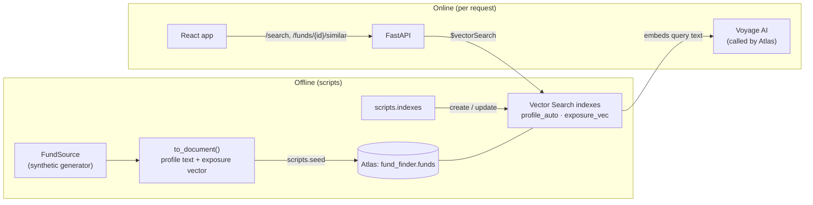
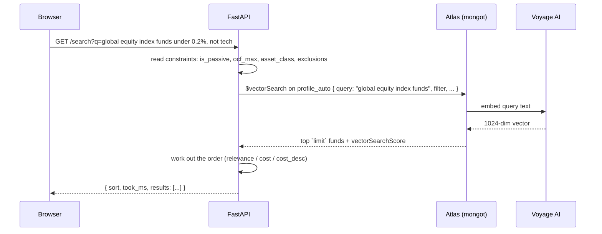

# How Fund Finder works

Fund Finder finds UK funds by **what they do**, not by what they're called. You can describe a
fund in plain English, or start from a fund and ask for others like it. Under the hood this is
similarity search with MongoDB Atlas Vector Search over two representations of each fund: its
**description** and its **portfolio exposure**.

This document explains the whole path: the data, how each fund becomes searchable, what happens
on each request, how results are combined and ordered, how quality is measured, and how it's
deployed. File references are relative to the repo root.

- [1. The big picture](#1-the-big-picture)
- [2. The data](#2-the-data)
- [3. Two ways to describe a fund](#3-two-ways-to-describe-a-fund)
- [4. Indexes](#4-indexes)
- [5. What happens on a search](#5-what-happens-on-a-search)
- [6. "Funds like this": text, exposure and both](#6-funds-like-this-text-exposure-and-both)
- [7. Ordering by cost](#7-ordering-by-cost)
- [8. The web app](#8-the-web-app)
- [9. Errors and limits](#9-errors-and-limits)
- [10. Measuring quality](#10-measuring-quality)
- [11. Running and deploying](#11-running-and-deploying)
- [12. Known limitations and next steps](#12-known-limitations-and-next-steps)

---

## 1. The big picture



| Piece | What it does | Where |
|---|---|---|
| Fund source | Supplies the fund universe (synthetic today) | `fundfinder/data/` |
| Document builder | Adds the two searchable fields to each fund | `fundfinder/documents.py`, `profile.py`, `exposure.py` |
| Seeder | Upserts funds into Atlas, removes stale ones | `scripts/seed.py` |
| Indexes | Defines and builds the two Vector Search indexes | `fundfinder/indexes.py`, `scripts/indexes.py` |
| API | Search, similar funds, fund details, metadata | `fundfinder/main.py`, `fundfinder/routes/`, `fundfinder/search.py` |
| Web app | Plain-English search UI with an expert mode | `web/` |
| Evaluation | Measures retrieval quality and latency | `scripts/eval.py`, `reports/eval.md` |

One design choice runs through everything: **the app never holds a Voyage API key**. Atlas
Automated Embedding embeds both the stored fund text and each incoming query, using the key
registered in Atlas. The app only sends text.

## 2. The data

### The fund model

Each fund (`fundfinder/models.py`) has:

- identity: `id`, `name`, `provider`
- classification: `ia_sector` (Investment Association sector), `asset_class`, `is_passive`,
  `tracked_index`
- cost: `ocf`, the ongoing charge in % a year
- text: `objective`
- holdings: `top_holdings` (name and weight)
- weights: `sector_weights` (11 GICS sectors), `region_weights` (8 regions) and
  `asset_class_weights` (7 asset types)

The weights are validated: each set must sum to at most 1, within a small rounding tolerance.

### Synthetic universe

There's no real fund data yet, so `fundfinder/data/synthetic.py` generates 300 realistic UK funds.
It's deterministic (`seed=42`), so every run produces the same funds. Providers are invented, and
real index and company names are used only for realism.

The universe has **deliberate structure** so search quality can be measured. Each structured
fund carries a `cluster_id`:

| Group | Count | What it is | Should find |
|---|---|---|---|
| Index trackers `trk_*` | 6 clusters × 5 funds | Different providers tracking the same index (S&P 500, FTSE 100, FTSE All-Share, MSCI World, gilts, global aggregate bonds) | The other 4 trackers of that index |
| Near-duplicate active funds `act_*` | 5 clusters × 4 funds | Active funds sharing a process, holdings and wording (global tech, Japan value, strategic bond, UK income, UK smaller companies) | The other 3 members |
| Outliers | 5 funds | One-offs with no true neighbour (biotech, UK property, frontier markets, gold, India) | Nothing close |
| Background | 245 funds | Varied funds built around 22 archetypes | n/a |

The amount of random noise is tuned per group: trackers are nearly identical, near-duplicates
vary more, and background funds scatter widely.

### Swapping in real data

Data comes in through the `FundSource` protocol (`fundfinder/data/source.py`), which has a single
method, `fetch() -> list[Fund]`. A real data provider's client would implement the same method,
and nothing downstream changes.

### Seeding

`scripts/seed.py` writes each fund as a MongoDB document with upserts, and deletes funds that are
no longer in the source. It never drops the collection, so the indexes survive a re-seed.
Re-seeding unchanged data modifies nothing, so Atlas doesn't re-embed anything.

## 3. Two ways to describe a fund

`to_document()` adds two derived fields to every fund. Each one powers a different kind of
similarity.

### 3a. `profile`: what the fund says it does

`build_profile()` (`fundfinder/profile.py`) writes a short, consistent paragraph from the
structured data:

> Kestrel S&P 500 Index Fund. The fund aims to replicate the performance of the S&P 500 Index
> before charges. It uses full physical replication, holding all index constituents in their
> index weights. IA sector: North America. Asset class: Equity. Passive index fund tracking the
> S&P 500 Index. Top holdings: Apple, Nvidia, Microsoft, Amazon, Meta Platforms, Alphabet Class A,
> Broadcom, Alphabet Class C, Berkshire Hathaway, Tesla. Main sectors: Information Technology 32%,
> Financials 13%, Health Care 10%. Region split: North America 100%.

The paragraph covers the name, objective, classification, passive or active, top holdings, the
three biggest sectors, and regions above 5%.

Atlas turns this text into a 1024-number **embedding** with Voyage `voyage-4`: a "meaning
fingerprint" where texts about similar things land close together. That's why a search for "big
UK dividend payers" finds UK equity income funds that never use those words.

### 3b. `exposure_vector`: what the fund actually holds

`exposure_vector()` (`fundfinder/exposure.py`) builds 26 numbers from the portfolio weights:

```
[ 11 GICS sectors | 8 regions | 7 asset types ]
```

1. **Sectors** are kept in whole-portfolio terms. A bond fund with 3% in equities has a
   near-empty sector block, and stays that way instead of being scaled up to look like an equity
   fund.
2. **Regions** and **asset types** are each rescaled to sum to 1.
3. The whole vector is **L2-normalised**, so cosine similarity compares the shape of the
   portfolio, not its size.

The block layout comes from `fundfinder/taxonomy.py`. Changing it means re-seeding and rebuilding
the `exposure_vec` index.

Why have both? They fail in different ways. Text can be fooled by wording; for example, two funds
from the same provider share boilerplate. Exposure can't tell apart funds with similar mixes but
different strategies: it confuses FTSE 100 and FTSE All-Share trackers, and finds bond funds hard
to separate. Combining the two is more reliable than either alone (see [section 10](#10-measuring-quality)).

## 4. Indexes

Both indexes are Atlas Vector Search indexes on the `funds` collection, defined in
`fundfinder/indexes.py`:

```jsonc
// profile_auto: Atlas embeds the `profile` text itself
{ "fields": [
  { "type": "autoEmbed", "modality": "text", "path": "profile", "model": "voyage-4" },
  { "type": "filter", "path": "asset_class" }, { "type": "filter", "path": "ia_sector" },
  { "type": "filter", "path": "ocf" },         { "type": "filter", "path": "is_passive" }
]}

// exposure_vec: we supply the vector
{ "fields": [
  { "type": "vector", "path": "exposure_vector", "numDimensions": 26, "similarity": "cosine" },
  /* same four filter fields */
]}
```

- **autoEmbed** means Atlas calls Voyage whenever a `profile` is inserted or changes, and again
  for query text at search time. Atlas stores the result as a 1024-dimension vector compared by
  dot product.
- **Filter fields** let searches narrow by asset class, IA sector, maximum cost and passive or
  active *before* ranking (pre-filtering), so filtered searches still return a full page of
  results.
- `scripts/indexes.py` is **idempotent**: it creates missing indexes, updates ones whose
  definition changed, and then waits until both are queryable. It compares only the fields we
  set, because Atlas adds defaults to stored definitions.
- The Free tier allows 3 search indexes; this uses 2.

## 5. What happens on a search

`GET /search?q=...` (`fundfinder/routes/api.py`):



### Step 1: query understanding

Embeddings capture what a query is *about*, but not limits, hard requirements or negation. "Not
tech" even pulls tech funds *closer*, because "tech" is in the text. So before searching,
`fundfinder/understanding.py` turns the constraint-like parts of the query into filters, using
deterministic rules:

| The query says | Becomes | Removed from the embedded text? |
|---|---|---|
| "under 0.2%", "fees below 15bps", "OCF under 0.25", "no more than 0.3% p.a." | `ocf_max` (cost cap, inclusive) | yes |
| "index fund", "tracker", "passive", "follows the US stock market" | `is_passive=true` | no: the words still help the match |
| "actively managed", "active", "stock picking", "not an index fund" | `is_passive=false` | only the negation |
| "bonds", "gilts", "equity", "shares", "property", "multi-asset", "money market" (exactly one named) | `asset_class` | no |
| "60% in shares" | `asset_class=Mixed Assets` | no |
| "no bonds or property" | `asset_class` not in (…), as a pre-filter | yes |
| "not tech", "without tech or banks", "excluding healthcare" | drop funds with **50% or more** in that sector | yes |
| "ex UK", "not in the US", "excluding China", "non-UK" | drop funds with **50% or more** in that region | yes |

Design choices:

- **Places and themes stay soft.** "Japan" or "healthcare" are left to the embedding, which
  handles them well. A hard filter would throw away near misses.
- **"Not tech" means "not mainly tech".** In the data, tech funds hold 60–81% technology, while
  broad global funds reach about 40%. Dropping every fund with *any* tech would leave nothing.
- **Guards against misreading.** A number counts as a cost only with a `%`/bps unit or a cost
  word, at most 3%, and not when followed by "in", "shares", "bonds" and so on. So "under 50% in
  shares" isn't a cost cap. "Index-linked gilts" isn't read as an index fund. If two asset classes
  are named ("shares and bonds"), neither is applied. A comma only continues a negated list when a
  conjunction closes it, so in "not an index fund, japan", "japan" stays a search term.
- **Your own filters win.** A filter set in the UI or as a query parameter overrides what was
  inferred.
- **Everything is reported back** in `interpretation`: the text that was embedded, and an `applied`
  list of `{key, label}` items. Pass a key in `ignore` to drop that inference
  (`?ignore=is_passive&ignore=not_sector:Information%20Technology`), or use `interpret=false` to
  turn the step off. The web app shows these as **Understood as** chips with a × on each.
- **Constraint-only queries** ("under 0.1%", "excluding tech, banks or energy") embed the neutral
  text "investment fund", because re-embedding the original would undo a negation.

Sector and region exclusions can't be pre-filters, because the indexes filter only on
`asset_class`, `ia_sector`, `ocf` and `is_passive`. So they're applied after the search, which
fetches 3 × `limit` to still fill the page. Sector and region weights are fetched for this but left
out of responses.

### Step 2: vector search

The pipeline (`vector_search_pipeline()` in `fundfinder/search.py`) is two stages:

```js
{ $vectorSearch: {
    index: "profile_auto", path: "profile",
    query: "lowest cost global tracker", model: "voyage-4",
    numCandidates: 200, limit: 10,
    filter: { $and: [ { is_passive: { $eq: true } }, { ocf: { $lte: 0.5 } } ] }  // only if set
}},
{ $project: { name: 1, provider: 1, /* ... */ score: { $meta: "vectorSearchScore" } } }
```

**Parameters** (shared by all search endpoints):

| Parameter | Default | Meaning |
|---|---|---|
| `limit` | 10 (1–100) | Results to return |
| `num_candidates` | 20 × `limit` (max 10,000) | How many candidates the approximate (ANN) search considers. Higher means more accurate but slower. Must be ≥ `limit`. |
| `exact` | false | Exhaustive (ENN) search instead of ANN. Used to check ANN accuracy. |
| `asset_class`, `ia_sector`, `ocf_max`, `is_passive` | none | Pre-filters |
| `sort` (`/search` only) | `auto` | See [section 7](#7-ordering-by-cost) |
| `interpret`, `ignore` (`/search` only) | `true`, none | Query understanding on or off, and inferences to drop (see above) |

**Scores.** Atlas returns `vectorSearchScore` in 0–1, which is `(1 + cosine) / 2`. So **0.5
means unrelated** and 1 means identical. The UI turns scores into labels: "Strong match" at
0.725 and above, "Good match" at 0.64 and above, and "Loose match" below that
(`web/src/lib/format.ts`).

## 6. "Funds like this": text, exposure and both

`GET /funds/{id}/similar?mode=text|exposure|both` uses the fund itself as the query.

| Mode | Query | Index |
|---|---|---|
| `text` | The fund's own `profile` text (Atlas embeds it) | `profile_auto` |
| `exposure` | The fund's stored `exposure_vector` as `queryVector` | `exposure_vec` |
| `both` (default) | Runs both concurrently, then fuses the two lists | both |

**The fund is excluded from its own results.** It's almost always its own nearest neighbour, so
each search asks for `limit + 1` and drops the fund.

### Reciprocal rank fusion (RRF)

The two modes produce scores on different scales: exposure scores bunch up near 1, and text
scores spread out more. Rather than mixing scores, `both` combines **ranks**
(`fundfinder/rrf.py`):

```
RRF score(fund) = Σ over lists  1 / (k + rank in that list)        k = 60
```

| Fund | Text rank | Exposure rank | RRF score |
|---|---|---|---|
| A | 1 | 1 | 1/61 + 1/61 = **0.0328** |
| B | 3 | 5 | 1/63 + 1/65 = **0.0313** |
| C | 1 | n/a | 1/61 = 0.0164 |

A fund that ranks well in both lists beats one that tops only one. Each list is fetched **2 ×
`limit` deep**, so a fund at, say, rank 14 in one list can still be promoted. Results in `both`
mode include `ranks: {text, exposure}` so the UI can explain each match: "Similar description and
holdings" (top `limit` in both), "Similar description", or "Similar holdings".

The fund page uses `both`. That's one Voyage call per page view, because the fund's text is
embedded once for the text half.

## 7. Ordering by cost

Similarity can't rank by price: "lowest cost" is an instruction about order, not a description of
a fund. So, alongside query understanding, `/search` reads the query for cost wording
(`fundfinder/intent.py`). A cost *cap* ("under 0.2%") is a filter (section 5); cost *wording*
changes the order:

| Query says | Order | Example triggers |
|---|---|---|
| Low cost | Cheapest first (`sort=cost`) | "low cost", "lowest-cost", "lower fees", "low charges", "low OCF", "cheap", "cheapest" |
| High cost | Most expensive first (`sort=cost_desc`) | "high cost", "highest cost", "higher fees", "most expensive", "priciest", "pricey" |
| Neither | Best match first (`sort=relevance`) | everything else |

- "Low" or "high" on their own don't count, so "low risk", "high yield" and "high income" keep
  best-match order.
- If a query mentions both, whichever comes first wins.
- **Only the matched funds are re-ordered.** The search still finds the `limit` closest funds;
  they're then shown by cost. Equal costs keep their match order. So "lowest cost global tracker"
  shows global trackers cheapest first, not the cheapest funds in the whole database.
- The response's `sort` field says which order was used. Passing `sort=relevance|cost|cost_desc`
  overrides the automatic choice. The web app's **Best match / Lowest cost / Highest cost** switch
  does exactly that.
- `/funds/{id}/similar` takes the same `sort` (default `relevance`; it has no query text to read).
  On a fund page, turning on **Only cheaper than X%** filters to cheaper funds *and* asks for
  `sort=cost`, so the matches are shown cheapest first.

## 8. The web app

`web/` is React 19 + TypeScript, built with Vite and served by FastAPI from `web/dist` (the
Dockerfile builds it). There's no client-side state library: page state lives in the URL, so
every search is a shareable link.

| Area | Files |
|---|---|
| Routes: `/` (search) and `/fund/:id` | `web/src/lib/router.ts`, `web/src/pages/` |
| API client and types | `web/src/lib/api.ts` |
| URL ↔ query, filters, settings and sort | `web/src/lib/params.ts` |
| Result rows, filters, the "How it works" guide | `web/src/components/` |

- **Search page:** a plain-English search box with example searches, simple filters (fund type,
  asset type, cost band), the order switch, and the **How it works** section with its guide.
- **Fund page:** key facts, objective, what the fund invests in, holdings, and "Funds like this"
  (`both` mode) with an explanation of how they were found.
- **Expert mode** (top-bar toggle, remembered per browser) shows the technical detail: scores,
  exposure fingerprints, `limit` / `numCandidates` / exact controls, the IA sector filter, test
  clusters, and a side-by-side text / exposure / both comparison on fund pages.
- **API docs:** the **API ↗** link in the top bar opens Swagger UI at `/docs`. The schema is at
  `/openapi.json`.

## 9. Errors and limits

| Situation | API response | What the UI does |
|---|---|---|
| Voyage rate limit hit while embedding a query | **429** with `Retry-After: 20` | Counts down and retries automatically |
| Database unreachable or a query fails | **503** `database unavailable` | Shows an error with a retry button |
| `MONGODB_URI` not set | App still starts; **503** `database not configured: set MONGODB_URI` | Same as above |
| Unknown fund | **404** `fund {id} not found` | Shows that message in the error note |
| Bad parameters (e.g. `num_candidates < limit`) | **422** | n/a |

`/health` pings the database and returns 200 or 503.

Atlas Free tier limits: 0.5 GB of storage, 100 operations per second, and 3 search indexes. Voyage
free keys are heavily rate-limited (3 requests per minute), which is what the 429 handling is for.

## 10. Measuring quality

`scripts/eval.py` runs against the live database and writes `reports/eval.md` and `.json`. It uses
the deliberate clusters as ground truth. For 22 query funds (2 per cluster), the expected
neighbours are the other members of the same cluster.

| Metric | Meaning |
|---|---|
| **P@5** | Share of the top 5 that are true neighbours. The ceiling is 0.71, because clusters have only 3–4 other members. |
| **R@10** | Share of true neighbours found in the top 10 |
| **ANN vs exact overlap** | How closely approximate search agrees with exhaustive search, at several `numCandidates` values |
| **p50 / p95 latency** | Typical and slow response times, measured from the client |
| **Outlier top-1 score** | Whether one-off funds look less similar to their nearest match than clustered funds do |

Latest results (Atlas Free cluster, `voyage-4`):

| Mode | P@5 | R@10 | p50 |
|---|---:|---:|---:|
| text | 0.65 | 0.98 | 208 ms |
| exposure | 0.62 | 0.92 | 35 ms |
| **both** | **0.68** | **0.98** | 240 ms |

What the results show:

- **Combining helps.** `both` has the best precision and keeps text's recall. All three modes
  find every index-tracker sibling.
- **Exposure struggles with bond funds.** For the strategic-bond near-duplicates it finds only a
  third of the siblings, because bond funds have near-empty sector blocks, so there's little to
  tell them apart.
- **Text has a provider bias.** The provider name is in the embedded text, so funds from the same
  provider look alike; the biotech outlier's nearest text match is a same-provider global fund.
- **ANN matches exact search** at this size (300 funds), even with `numCandidates` as low as 20.
  Expect that to change with a real-sized universe, so re-check it then.
- **Most text latency is embedding the query** (about 175 ms of 208 ms). Exposure search, which
  needs no embedding, takes about 35 ms.

Re-run with `uv run python -m scripts.eval`. Free Voyage keys may need the built-in rate-limit
retries.

## 11. Running and deploying

**Configuration** is environment-only (`fundfinder/config.py`); `.env.example` lists every
variable.

| Variable | Default | Notes |
|---|---|---|
| `MONGODB_URI` | none | Required to serve data. Use a read-only user in production. |
| `MONGODB_DB` | `fund_finder` | |
| `EMBED_MODEL` | `voyage-4` | Must match the model in the `profile_auto` index |
| `PORT` | 80 in the Docker image | Docker compose sets 8000 |
| `VOYAGE_API_KEY` | none | Only for the local Atlas container; the app never uses it |

**Locally**, either:

- `docker compose up -d` runs MongoDB Atlas Local (with autoEmbed) plus the app on
  http://localhost:8000, rebuilding the app image each time; or
- `uv run uvicorn fundfinder.main:app --reload` against any Atlas cluster, with
  `npm run dev` in `web/` for live frontend reloading.

Then seed the data and build the indexes: `python -m scripts.seed`, then `python -m scripts.indexes`.

**Vercel** builds `Dockerfile.vercel` (Container Runtime) on every push to `main`. The
multi-stage build compiles the React app, installs the Python dependencies with `uv`, and runs
uvicorn on port 80. Set `MONGODB_URI` in the Vercel project. Vercel has no fixed outgoing IP
addresses for containers, so Atlas Network Access must allow `0.0.0.0/0`; the README covers that
trade-off.

**Quality gates:** GitHub Actions runs ruff (lint and format) and pytest for the API, and
typecheck, Vitest and a production build for the web app.

## 12. Known limitations and next steps

- **Synthetic data.** The clusters were built to be found, so the evaluation compares the modes
  with each other; it doesn't predict quality on real data.
- **Provider bias in text similarity.** Removing provider names (and boilerplate) from `profile`
  is the obvious next change.
- **Weak exposure signal for bonds.** Adding bond-specific dimensions (duration, credit quality,
  government vs corporate split) would help.
- **Query understanding is rule-based.** It handles common wording, not every phrasing, and it
  has no region or IA-sector filters because the indexes don't filter on region. An LLM-based
  parser could replace `interpret()` and return the same structure; adding a `main_region` filter
  field to the indexes would allow hard region filters.
- **No performance or risk data.** Results say nothing about past returns, volatility or ratings.
- **Scale.** At 300 funds ANN is effectively exact. With thousands of funds, tune `numCandidates`
  using the overlap report, and move off the Free tier's throughput limits.
